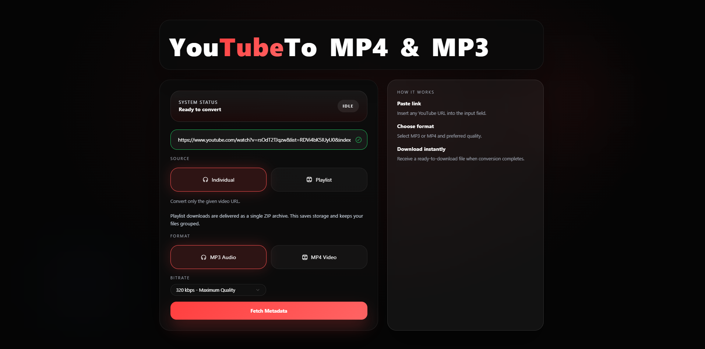
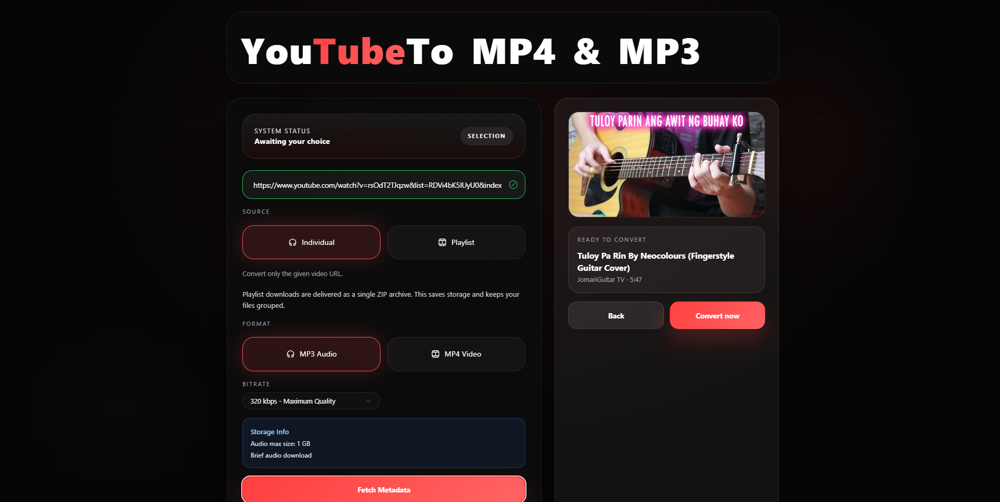
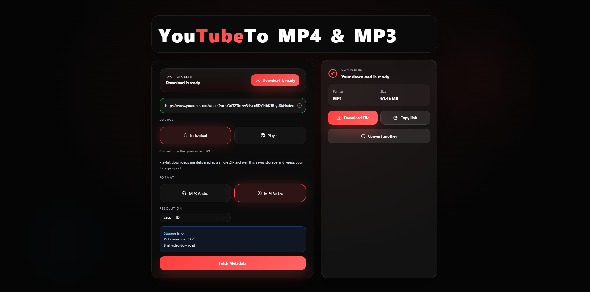

# 🎬 YouTube to MP4 & MP3 Converter

**Video/Audio Conversion Tool** · `Windows Forms`

Desktop application for converting YouTube videos to MP4 or MP3 with metadata preview, playlist support, and bitrate selection.

## Screenshots

### Input stage — users paste a YouTube URL and choose their desired output format (MP4 video or MP3 audio) and quality. The "How It Works" panel first-time users through the process. The IDLE status confirms the system is ready to fetch.

### Verification step — after fetching, the user sees the video thumbnail and title to confirm they're converting the right video before committing to the download. Prevents wasting time on the wrong URL.

### Delivery stage — conversion is complete. Users can download the file directly, copy the shareable link, or immediately start converting another video. The file size is shown so users know what to expect.

## Features

- Paste YouTube URL and fetch video metadata
- Convert to MP4 (video) or MP3 (audio)
- Individual video or playlist mode
- Selectable bitrate for audio extraction
- Video thumbnail and title preview before conversion
- One-click download with copy link option

## Tech Stack

- C#
- WPF
- .NET
- yt-dlp
- FFmpeg

## About

Windows desktop utility that wraps yt-dlp and FFmpeg to provide a GUI for downloading and converting YouTube content. Supports single videos and playlists with format selection and metadata preview.

---

Built by [Mark Crysler Baddo](https://github.com/Kuraisura) · [Portfolio](https://kuraisler.xyz)
